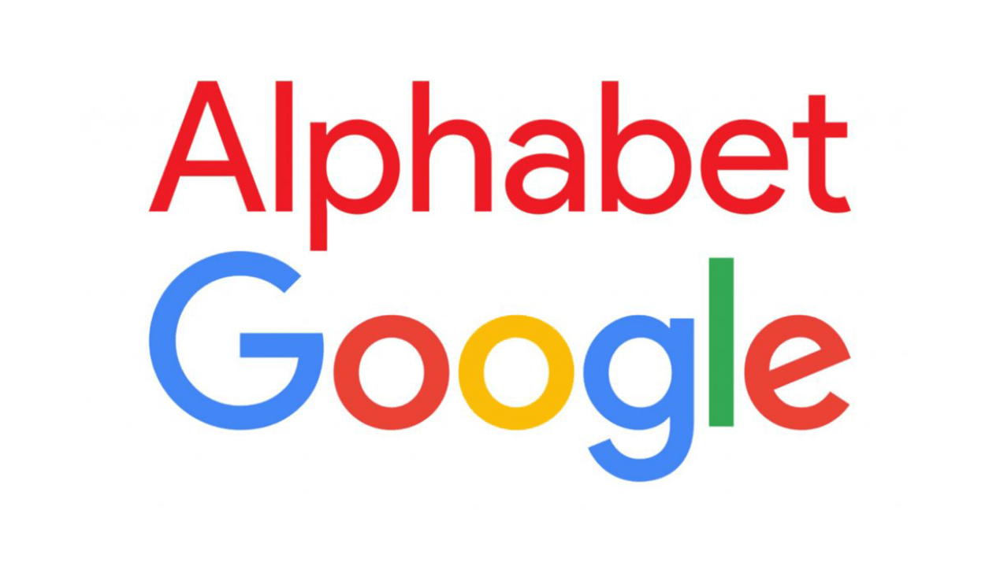

<p align="center">
  <a href="https://jinawinwin.github.io/SEC_Alphabet/">
    
  </a>
</p>
<p align="center">
  <a href="https://jinawinwin.github.io/SEC_Alphabet/" title="🔗 대시보드 바로가기">
    
  </a>
</p>

# SEC_Alphabet — Alphabet Inc. SEC 재무 대시보드

SEC EDGAR의 XBRL 공시 데이터(10-K · 10-Q)를 크롤링해 Alphabet Inc.(GOOGL / GOOG, CIK 0001652044)의
**연간 · 반기 · 분기** 실적을 정리하고 분석한 대시보드입니다.

**🔗 대시보드: https://jinawinwin.github.io/SEC_Alphabet/**

[](https://github.com/jinawinwin/SEC_Alphabet/actions/workflows/update-data.yml)

## 대시보드 구성

| 영역 | 내용 |
|---|---|
| KPI 카드 | 최신 연간 매출·순이익·영업이익률·FCF, 최신 분기 매출·EPS |
| 핵심 인사이트 | 5년 CAGR, 분기 YoY 성장, 영업외손익 영향, CapEx·주주환원 등 자동 요약 |
| 시각화 | 연간 실적 막대, 손익 흐름도(Sankey), 분기 매출·YoY, 반기 H1/H2 비교, 수익성 추이, 비용 구조, 현금흐름, 재무상태 |
| 수치 테이블 | **연간(Annual) · 반기(Half-year) · 분기(Quarterly)** 3개 테이블 — 손익·현금흐름·재무상태·주요 비율 |
| 피어 비교 | 글로벌 경쟁사 10곳의 최신 연간 실적 비교 테이블 |
| 내보내기 (오른쪽 플로팅 창) | **PDF**: 대시보드 화면 전체를 PDF로 저장 · **Excel**: 연간/반기/분기 중 원하는 기간을 골라 .xlsx 다운로드 |

## 저장소 구조

```
├── data/
│   ├── raw/                     # SEC 원본 JSON (companyfacts, submissions)
│   └── processed/               # annual.csv · half_year.csv · quarterly.csv · peers.csv
├── docs/                        # GitHub Pages 대시보드
│   ├── index.html
│   └── data/dashboard.json
├── scripts/
│   ├── fetch_sec.py             # SEC EDGAR 크롤러
│   └── build_data.py            # 기간별 가공 · 비율 계산 · README 피어 표 갱신
└── .github/workflows/update-data.yml   # 매월 자동 업데이트 에이전트
```

## 자동 업데이트

GitHub Actions 워크플로(`update-data.yml`)가 **매월 1일과 5일 09:00 KST**에 실행되어
SEC에서 최신 데이터를 내려받고, 가공 데이터·README 피어 표를 갱신해 커밋한 뒤 대시보드를 다시 배포합니다.
Actions 탭에서 **Run workflow**로 수동 실행도 가능합니다.

## 데이터 처리 방식

- 출처: `https://data.sec.gov/api/xbrl/companyfacts/CIK0001652044.json` (US-GAAP 태그)
- 같은 기간 값이 여러 공시에 있으면 **가장 최근 제출된 값**(재작성 반영)을 사용합니다.
- 분기: 10-Q의 3개월 수치 우선, 없으면 누적(YTD) 값의 차이로 계산 — **Q4 = 연간 − 9개월 누적**
- 반기: **H1 = 6개월 누적(10-Q)**, **H2 = 연간 − H1**
- 재무상태 항목은 기간 말(분기 말, 6/30, 12/31) 잔액
- EPS: 2022년 7월 20:1 주식분할 이전 값은 분할 기준으로 조정, Q4·H2 EPS는 차감 근사치

## 로컬 실행

```bash
python scripts/fetch_sec.py
python scripts/build_data.py
python -m http.server 8000 --directory docs
```

SEC는 연락처가 담긴 User-Agent를 요구합니다. 필요하면 `SEC_USER_AGENT` 환경변수로 바꿀 수 있습니다.

## 글로벌 피어 (Global Peer Firms)

<!-- PEERS:START -->
_SEC XBRL 최신 연간 보고서(10-K / 20-F) 기준 · 단위: 십억 달러(USD bn) · 갱신: 2026-10-25_

| 기업 | 티커 | 국가 | 상장 | Alphabet과의 경쟁 영역 | 회계연도 말 | 매출 | 영업이익률 | 순이익 | R&D/매출 |
|---|---|---|---|---|---|--:|--:|--:|--:|
| Alphabet (기준) | GOOGL | 미국 | NASDAQ | 검색·YouTube 광고, Google Cloud, Android, Waymo | 2025-12-31 | 402.8 | 32.0% | 132.2 | 15.2% |
| Microsoft | MSFT | 미국 | NASDAQ | 클라우드(Azure), 검색(Bing), 생성형 AI, 생산성 SW | 2026-06-30 | 331.8 | 46.8% | 133.7 | 10.7% |
| Apple | AAPL | 미국 | NASDAQ | 모바일 OS(iOS vs Android), 앱스토어, 하드웨어 | 2025-09-27 | 416.2 | 32.0% | 112.0 | 8.3% |
| Amazon | AMZN | 미국 | NASDAQ | 클라우드(AWS), 디지털 광고, 스마트 기기 | 2025-12-31 | 716.9 | 11.2% | 77.7 | — |
| Meta Platforms | META | 미국 | NASDAQ | 디지털 광고, 소셜/동영상(YouTube 경쟁), AI 모델 | 2025-12-31 | 201.0 | 41.4% | 60.5 | 28.5% |
| Oracle | ORCL | 미국 | NYSE | 클라우드 인프라(OCI), 데이터베이스 | 2026-05-31 | 67.4 | 30.6% | 17.1 | 15.3% |
| NVIDIA | NVDA | 미국 | NASDAQ | AI 가속기(TPU vs GPU), AI 인프라 | 2026-01-25 | 215.9 | 60.4% | 120.1 | 8.6% |
| Alibaba Group | BABA | 중국 | NYSE / HKEX | 클라우드(Alibaba Cloud), 전자상거래 광고, AI 모델 | 2026-03-31 | 148.4 | 4.9% | 15.0 | 6.5% |
| Baidu | BIDU | 중국 | NASDAQ / HKEX | 검색 광고, 자율주행(Waymo vs Apollo), AI 모델 | 2025-12-31 | 18.5 | -4.5% | 0.8 | 15.8% |
| Tencent | 0700.HK | 중국 | HKEX | 디지털 광고, 클라우드, 게임·콘텐츠 | SEC 미제출 | — | — | — | — |
| NAVER | 035420.KS | 한국 | KRX | 검색 광고, 클라우드, 커머스 | SEC 미제출 | — | — | — | — |
<!-- PEERS:END -->

---
정보 제공 목적의 자료이며 투자 권유가 아닙니다.
